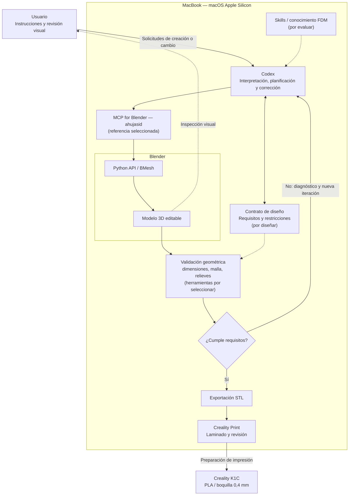

# ARQ-001 — Arquitectura de alto nivel del Laboratorio de Modelado 3D Agéntico

**Estado: IN PROGRESS — En elaboración**  
**Fecha:** 2 de noviembre de 2026  
**Fase:** 2 — Diseño de la solución (borrador anticipado)  
**Dependencia:** validación de resultados de la Fase 1 — Investigación y selección tecnológica.

## Objetivo
Describir visualmente la arquitectura candidata para modelar objetos imprimibles mediante instrucciones en lenguaje natural, usando Codex y Blender en un MacBook Apple Silicon. Este diagrama **no representa una implementación ya validada**.

## Arquitectura candidata

## Responsabilidades propuestas

| Elemento | Responsabilidad |
|---|---|
| Codex | Interpretar instrucciones, decidir operaciones y gestionar iteraciones. |
| Contrato de diseño | Registrar dimensiones, restricciones y requisitos verificables. |
| MCP for Blender | Intercambiar órdenes y resultados entre Codex y Blender. |
| Blender / Python API | Construir, editar y visualizar geometría real. |
| Validador | Comprobar dimensiones, topología y relieves físicos; reportar errores. |
| Creality Print | Revisar el STL y preparar el laminado para la K1C. |

## Caso de uso que guía el diseño — CU-01
Macetero cuadrado de **150 × 150 mm**, **60 mm de alto**, con ladrillos en **relieve geométrico real** en sus cuatro caras, modificables por instrucciones posteriores. Espesor de pared **pendiente de confirmar: 2 mm o 20 mm**. Verificar esquinas, geometría y STL antes de laminar.

## Pendientes antes de cerrar la Fase 2
1. **FLU-001:** definir flujo de creación, edición incremental, fallos y reintentos.
2. **CON-001:** definir formato y persistencia del contrato de diseño.
3. **VAL-001:** seleccionar verificadores existentes, métricas y condiciones de aceptación.
4. Contrastar la arquitectura con evidencia de la Fase 1, en particular compatibilidad macOS ARM64 y límites reales del MCP.
5. Determinar si el validador vive dentro de Blender, fuera de él o es una combinación.

**Nota:** El diagrama es una hipótesis de trabajo. No implica que cada componente sea un servicio independiente ni obliga a desarrollar herramientas nuevas.
