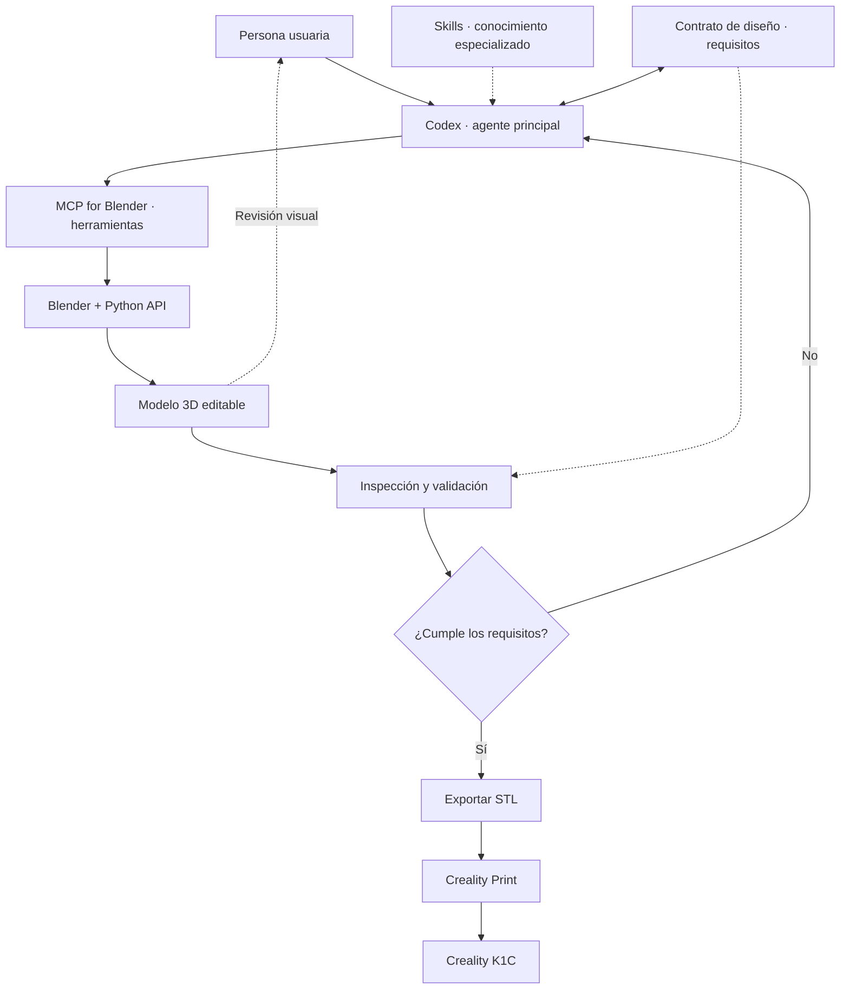

# CAP-001 — Guía didáctica: agentes, skills y MCP en un laboratorio de modelado 3D

**Estado:** IN PROGRESS — material de apoyo para taller o clase  
**Versión:** 0.1 · 2 de noviembre de 2026  
**Proyecto:** Laboratorio de Modelado 3D Agéntico  
**Entorno previsto:** MacBook Apple Silicon, Codex, Blender, MCP for Blender y Creality Print.

> **Propósito:** explicar conceptos, ilustrar el flujo de trabajo y servir de base para una clase práctica. Es una arquitectura conceptual; no documenta una instalación validada.

## 1. Objetivos de aprendizaje

Al finalizar, una persona debería poder:
1. Diferenciar **agente**, **skill** y **herramienta/MCP**.
2. Explicar cómo Codex interpreta una petición y utiliza Blender.
3. Reconocer por qué una ejecución exitosa no garantiza geometría correcta.
4. Distinguir corrección durante una sesión de aprendizaje persistente.
5. Justificar cuándo conviene un agente con skills frente a varios agentes.

## 2. Conceptos esenciales

**Agente (Codex).** Recibe la intención del usuario, decide próximos pasos, utiliza herramientas e interpreta resultados. No debe confundirse con Blender ni con el servidor MCP.

**Skill.** Paquete de instrucciones, referencias y, según el caso, recursos que orientan al agente en tareas especializadas. Ejemplos hipotéticos: modelado paramétrico, buenas prácticas FDM y validación de mallas. Una skill no garantiza por sí misma que una acción se ejecute.

**Herramienta / MCP.** Interfaz que permite al agente consultar o modificar sistemas externos. MCP es un protocolo de integración; **MCP for Blender** es una implementación que conecta el agente con operaciones de Blender. No equivale a otro agente.

**Blender y su API de Python.** Entorno donde se construye, modifica e inspecciona la geometría.

**Validador.** Procedimiento o herramienta que comprueba propiedades medibles, como dimensiones, topología y presencia de relieves. Su disponibilidad y grado de automatización son materia de investigación.

**Contrato de diseño.** Especificación explícita de los requisitos que deben conservarse entre modificaciones: medidas, espesor, relieve, etc. Su formato todavía no está definido.

## 3. Arquitectura conceptual

**Nota didáctica:** las skills no tienen que ejecutarse en un orden fijo ni actuar como programas independientes. Codex puede consultarlas cuando corresponda. El diagrama simplifica las interacciones reales.

## 4. Recorrido guiado: macetero con ladrillos

**Requisitos conocidos:** planta cuadrada de 150 × 150 mm, altura 60 mm, ladrillos exteriores en relieve geométrico real, PLA, K1C con boquilla de 0,4 mm. **Por confirmar:** espesor de pared (2 o 20 mm), base y drenaje.

| Paso | Acción | Concepto que enseña | Evidencia esperada |
|---|---|---|---|
| 1 | La persona pide el macetero en español. | Intención del usuario | Requisitos interpretados y dudas explícitas |
| 2 | Codex consulta conocimientos pertinentes. | Skills | Criterios de modelado y fabricación |
| 3 | Codex decide la secuencia de operaciones. | Planificación | Plan de cuerpo, paredes y ladrillos |
| 4 | Codex utiliza MCP para operar Blender. | Herramientas | Objetos y geometría en la escena |
| 5 | Inspecciona dimensiones, relieve y malla. | Validación | Resultados comprobables, no solo éxito de llamada |
| 6 | Si algo falla, diagnostica y corrige. | Recuperación | Nueva ejecución con requisitos preservados |
| 7 | La persona pide ladrillos más pequeños. | Edición incremental | Cambia el patrón, no el tamaño exterior |
| 8 | Exporta STL y lo abre en Creality Print. | Fabricación | Archivo procesable; impresión física aún no garantizada |

### Ejemplo de diálogo para el taller

**Usuario:** «Crea un macetero cuadrado de 150 por 150 milímetros y 60 de alto, con ladrillos en relieve por fuera».

**Agente (comportamiento deseado):** «Antes de modelar, necesito confirmar el espesor de las paredes: ¿2 o 20 milímetros?».

**Usuario:** «2 milímetros».

**Agente (comportamiento deseado):** planifica la geometría, utiliza Blender, inspecciona resultados y comunica qué verificó.

**Usuario:** «Reduce el tamaño de los ladrillos, pero mantén las dimensiones exteriores».

**Agente (comportamiento deseado):** modifica el patrón existente, comprueba dimensiones y preserva el resto de las restricciones.

Estos diálogos son **escenarios ilustrativos**, no pruebas de que el sistema ya funcione.

## 5. Qué pasa cuando algo sale mal

Hay al menos tres niveles de fallo:

- **Ejecución:** Blender o la herramienta devuelve un error.
- **Geometría:** la operación termina, pero la malla, las medidas o el relieve no cumplen el contrato.
- **Fabricación:** el STL puede abrirse, pero el laminado o la impresión presentan problemas.

La recuperación deseada es: **detectar → diagnosticar → preservar o restaurar un estado válido → corregir → verificar otra vez**. Los mecanismos concretos de reversión y validación se diseñarán en entregables posteriores.

**Aprendizaje vs. memoria:** corregir un error dentro de una conversación no implica aprendizaje permanente. Para reutilizar soluciones en futuras sesiones haría falta registrar errores, causas y correcciones mediante un mecanismo explícito.

## 6. ¿Un agente o varios?

**Hipótesis inicial:** un Codex con skills especializadas y herramientas MCP. Es más simple de operar y depurar.

**Alternativa a estudiar:** agentes separados para planificación, modelado y validación. Puede aportar especialización, pero introduce coordinación, estados compartidos y más puntos de fallo.

**Criterio:** no adoptar multiagente por moda; exigir evidencia de que resuelve un problema concreto que el enfoque simple no cubre.

## 7. Taller sugerido (60–75 minutos)

| Bloque | Tiempo | Dinámica |
|---|---:|---|
| Introducción y objetivos | 10 min | Diferenciar agente, skill y MCP |
| Diagrama de arquitectura | 10 min | Seguir una instrucción desde Codex a Blender |
| Caso del macetero | 20 min | Identificar decisiones, herramientas y verificaciones |
| Errores y recuperación | 15 min | Discutir tres fallos y cómo detectarlos |
| Debate de diseño | 10 min | Un agente vs. múltiples agentes |
| Cierre y preguntas | 5–10 min | Qué está probado y qué falta investigar |

**Actividad sin instalar software:** entregar a grupos la petición «ladrillos más pequeños, sin cambiar el macetero» y pedirles identificar: (a) requisitos que deben mantenerse, (b) skill pertinente, (c) herramienta que actuaría, (d) validaciones necesarias y (e) respuesta ante fallo.

## 8. Investigación de componentes existentes — pendiente

Antes de desarrollar código propio, evaluar skills y herramientas disponibles según:
- Compatibilidad real con Codex y macOS ARM64.
- Funcionalidad demostrada para modelado editable y validación FDM.
- Documentación, licencias, mantenimiento y actividad de comunidad.
- Experiencias verificables de usuarios y facilidad de instalación.
- Limitaciones y dependencias adicionales.

**Referencias candidatas, aún sin validación integral:**
- MCP for Blender: https://github.com/ahujasid/mcp-for-blender
- Blender skills (candidato a revisar): https://github.com/EL4CTEO/blender-skills
- MCP Printable: https://github.com/AaronGoldsmith/mcp-printable

## 9. Preguntas para discusión

1. ¿Qué parte del trabajo corresponde a Codex y cuál a Blender?
2. ¿Por qué «la herramienta devolvió éxito» no significa «modelo correcto»?
3. ¿Cómo se comprueba que un ladrillo es geometría real y no textura?
4. ¿Qué información debería persistir entre sesiones?
5. ¿Qué evidencia justificaría incorporar otro agente?

## 10. Estado y próximos entregables

- **ARQ-001:** arquitectura de alto nivel, happy path; en progreso.
- **CAP-001:** este material didáctico y futuro mapa de capacidades; en progreso.
- **FLU-001:** flujos de error y recuperación; pendiente.
- **CON-001:** contrato estructurado del diseño; pendiente.
- **VAL-001:** estrategia de validación; pendiente.

**Advertencia:** no se ha ejecutado ni validado técnicamente el flujo de punta a punta. Este documento sirve para explicar y orientar el diseño, no para afirmar que el laboratorio ya está implementado.
