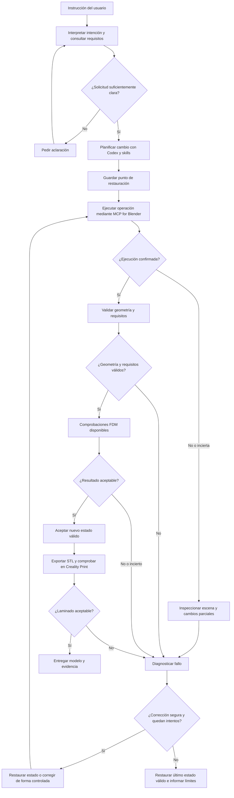

# FLU-001 — Manejo de errores y recuperación del laboratorio 3D
**Estado:** IN PROGRESS — propuesta conceptual, pendiente de validación técnica  
**Versión:** 0.2 · 2 de noviembre de 2026  
**Fase:** 2 — Diseño de solución  
**Relacionado con:** ARQ-001 (arquitectura), CAP-001 (agentes, skills y herramientas), CON-001 (contrato de diseño, pendiente), VAL-001 (validación, pendiente).

## 1. Propósito
Diseñar cómo Codex puede detectar, diagnosticar y recuperarse de errores durante el modelado interactivo con Blender, **sin comprometer el último modelo válido**. Este documento no presupone que las funciones descritas ya estén implementadas.

## 2. Principios de diseño
1. **Separar ejecución de resultado:** una llamada MCP exitosa no demuestra que la geometría sea correcta.
2. **Preservar estado:** antes de operaciones importantes, crear un punto recuperable; definir posteriormente el mecanismo concreto (archivo `.blend`, copia de escena u otro).
3. **Validar contra requisitos:** comprobar dimensiones, relieve geométrico, topología y restricciones conocidas.
4. **Corrección acotada:** limitar reintentos y evitar bucles indefinidos.
5. **No ocultar fallos:** informar qué se verificó, qué falló y qué quedó sin comprobar.
6. **Reutilizar antes de desarrollar:** investigar herramientas y skills existentes, incluida la viabilidad de MCP Printable, antes de programar.
7. **Registrar aprendizajes explícitamente:** una corrección en sesión no equivale a memoria permanente.

## 3. Flujo de ejecución y recuperación

**Nota:** el bucle de retorno desde Creality Print es conceptual: todavía no se ha establecido una integración automática con el laminador. La revisión podría requerir intervención manual.

## 4. Taxonomía de errores

| Código | Tipo | Ejemplo con el macetero | Detección propuesta | Respuesta esperada |
|---|---|---|---|---|
| INT-01 | Interpretación | «Ladrillos más pequeños» reduce el macetero completo | Comparación con requisitos originales | Restaurar y reformular cambio |
| EXE-01 | Ejecución | Blender rechaza una operación o MCP pierde conexión | Resultado de herramienta + inspección de escena | Comprobar cambios parciales antes de reintentar |
| GEO-01 | Geometría | Esquinas discontinuas, ladrillos no físicos, medidas alteradas | Inspección y validación de malla | Corregir y volver a validar |
| FDM-01 | Fabricación | Detalles incompatibles con el proceso o problemas de malla | Validación FDM disponible y laminado | Ajustar diseño o comunicar restricción |
| STA-01 | Estado | Un cambio destruye objetos anteriores | Comparación con punto recuperable | Revertir al último estado válido |
| VAL-01 | Verificación | El validador falla o no puede confirmar un requisito | Estado explícito «no verificado» | No declarar éxito; solicitar revisión |

## 5. Contrato mínimo de una operación (propuesta)

Cada operación debería poder registrar:
- **Identificador:** operación y solicitud original.
- **Estado anterior:** referencia a una versión recuperable.
- **Intención:** cambio solicitado y restricciones que deben mantenerse.
- **Acción:** herramienta utilizada y parámetros relevantes.
- **Resultado técnico:** éxito, error o estado incierto.
- **Validaciones:** resultados y evidencias de dimensiones, geometría y fabricación.
- **Decisión:** aceptar, corregir, revertir o solicitar intervención.
- **Historial:** intentos, diagnósticos y cambios aplicados.

No se ha elegido todavía un formato de almacenamiento ni un sistema de versionado.

## 6. Ejemplo didáctico: reducir el tamaño de los ladrillos

1. Estado inicial válido: macetero exterior de **150 × 150 × 60 mm** con ladrillos en relieve real.
2. Usuario: «Haz los ladrillos más pequeños, pero conserva las dimensiones del macetero».
3. Codex interpreta el cambio y conserva las restricciones; guarda un punto de restauración.
4. Utiliza la herramienta de Blender para modificar el patrón.
5. Si Blender reporta éxito, **aun así** verifica dimensiones exteriores y existencia del relieve.
6. Si el macetero ahora mide 140 mm de ancho, la validación falla: no se acepta el resultado.
7. Codex restaura el estado anterior, ajusta su plan y realiza un intento controlado.
8. Si no consigue cumplir, entrega el último modelo válido e informa el error.

**Pendientes del caso:** espesor de pared (2 o 20 mm), base y drenaje.

## 7. Reintentos, reversión y memoria

**Reintentos:** proponer un límite configurable por operación, sin fijar aún una cifra. No reintentar ciegamente acciones que podrían duplicar objetos o alterar el estado.

**Reversión:** comprobar primero que existe una copia utilizable y que restaurarla no elimina cambios aceptados posteriormente.

**Memoria de errores:** posible registro de contexto, causa, solución probada y evidencia. Antes de implementarlo, estudiar si las capacidades nativas de Codex, las skills o repositorios existentes cubren la necesidad.

## 8. Dependencias y decisiones abiertas
- **CON-001:** representación y persistencia de requisitos geométricos.
- **VAL-001:** verificaciones automáticas disponibles, resultados y umbrales.
- **ARQ-001:** mecanismos reales de integración y observabilidad.
- **CAP-001:** skills reutilizables y herramientas efectivamente compatibles.
- Definir la estrategia de snapshots, transacciones o restauración en Blender.
- Confirmar si MCP Printable aporta verificaciones útiles y si puede integrarse sin código propio.
- Definir qué parte de Creality Print puede verificarse automáticamente y cuál es manual.
- Establecer criterios para detener reintentos y escalar al usuario.

## 9. Observabilidad, registro de errores y mejora continua

**Objetivo:** usar los fallos y sus correcciones para reducir errores repetidos y mejorar la confiabilidad del pipeline, sin asumir que Codex aprende automáticamente ni convertir toda corrección en una regla permanente.

### Tres niveles de madurez
1. **Recuperación:** detectar el fallo, diagnosticarlo, reintentar de manera controlada o restaurar el último estado válido.
2. **Observabilidad:** conservar evidencia de operaciones, resultados, validaciones, errores y correcciones para encontrar patrones.
3. **Mejora continua:** revisar registros y, solo con evidencia suficiente, actualizar procedimientos, documentación, skills o selección de herramientas.

### Registro mínimo propuesto por evento
- Identificador de ejecución, fecha/hora, versión del modelo y operación solicitada.
- Requisitos que debían preservarse y estado previo recuperable.
- Herramienta/skill implicada y versión, cuando esté disponible.
- Tipo de error (INT, EXE, GEO, FDM, STA o VAL), mensaje y contexto.
- Diagnóstico, corrección intentada, cantidad de reintentos y resultado.
- Evidencia de validación posterior y decisión final: aceptado, revertido o pendiente.
- Referencia a una solución conocida, **si ha sido verificada**.

Evitar guardar secretos, credenciales o datos personales innecesarios. El formato y la ubicación del registro quedan por definir; priorizar soluciones ya existentes antes de desarrollar un sistema propio.

### Ciclo de mejora
**Registrar → Agrupar fallos recurrentes → Investigar causa → Proponer cambio → Probar con un caso reproducible → Comparar métricas → Adoptar o revertir el cambio.**

Una solución solo pasa al catálogo de procedimientos recomendados si se documenta su contexto y se comprueba que funciona de manera reproducible. Registrar también las soluciones fallidas para no repetirlas ciegamente.

### Métricas candidatas
- Porcentaje de operaciones que pasan todas las validaciones al primer intento.
- Número de reintentos por modificación aceptada.
- Frecuencia de restauraciones del último estado válido.
- Tiempo hasta obtener un STL validado y procesable en Creality Print.
- Reaparición de errores previamente clasificados.
- Casos en que la validación no pudo emitir un resultado concluyente.

**Precaución metodológica:** comparar escenarios equivalentes y versiones conocidas del pipeline. Una disminución aparente de errores no demuestra mejora si se redujo la complejidad de las pruebas o se omitieron verificaciones.

### Ejemplo con el macetero
Si el patrón de ladrillos falla repetidamente en las esquinas, registrar la operación, el estado de la escena, el fallo y la corrección probada. Tras reproducir y verificar una solución, evaluar si corresponde ajustar la skill de Geometry Nodes, el procedimiento de modelado o las verificaciones. El cambio debe poder revertirse si perjudica otros modelos.

### Plan por fases
- **Fase 2:** definir eventos, campos, métricas, criterios de promoción y responsabilidades.
- **Fase 3:** instrumentación mínima, preferentemente reutilizando logs y capacidades existentes.
- **Fase 4:** recoger datos en pruebas repetibles del CU-01.
- **Fase 5:** analizar tendencias y mejorar skills/procedimientos con cambios medibles.

**Distinción clave:** registro de errores ≠ memoria consultable ≠ entrenamiento del modelo. Son capacidades diferentes; la persistencia y recuperación de conocimiento deberán investigarse por separado.

## 10. Criterios de aceptación de FLU-001
- Distingue errores de interpretación, ejecución, geometría, fabricación, estado y validación.
- Explica qué ocurre si la ejecución termina en estado incierto.
- Evita aceptar cambios sin comprobaciones relevantes.
- Contempla restauración del último estado válido y reintentos limitados.
- Identifica claramente qué componentes aún no están investigados o implementados.
- Puede explicarse en un taller mediante el ejemplo del macetero.
- Define qué registrar, cómo evaluar mejoras y cuándo promover una corrección a procedimiento recomendado.

**Estado actual:** borrador de diseño, **no** flujo probado. El cierre depende de los resultados de la Fase 1 y de los contratos CON-001 y VAL-001.
