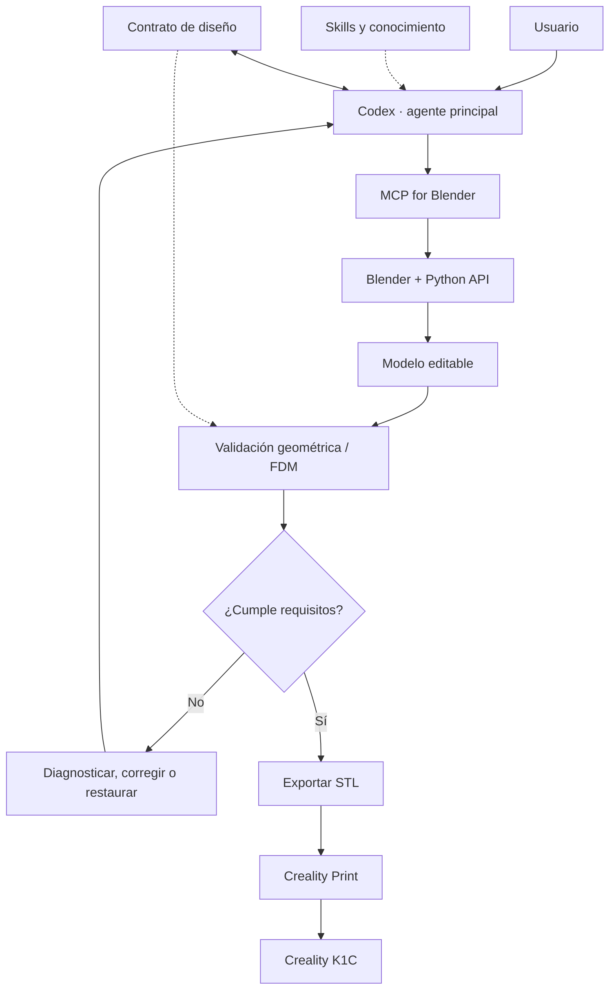

# Laboratorio de Modelado 3D Agéntico — Resumen de sesión y punto de reanudación

**Fecha:** 2 de noviembre de 2026  
**Estado del proyecto:** Fase 1 (investigación tecnológica) aún por cerrar; Fase 2 (diseño) adelantada parcialmente, **IN PROGRESS**.  
**Objetivo de este documento:** retomar la conversación sin perder decisiones, hipótesis, pendientes ni próximos pasos.

## 1. Visión acordada

Construir un laboratorio local donde **Codex** reciba instrucciones en español, opere **Blender** mediante **MCP for Blender**, permita observar y modificar modelos 3D de manera incremental, valide la geometría y produzca un STL para preparar en **Creality Print** e imprimir en una **Creality K1C**.

**Principio rector:** investigar y reutilizar herramientas, skills y proyectos de código abierto **antes de escribir código propio**. No iniciar auditoría ni instalación todavía. La arquitectura debe mantenerse tan simple como sea posible.

**Entorno de referencia:** MacBook con Apple Silicon (macOS ARM64); considerar portabilidad futura a Linux. No agregar Docker ni servicios cloud si no son necesarios.

## 2. Caso de uso CU-01: macetero

- Dimensiones exteriores: **150 × 150 mm** de planta, **60 mm** de alto.
- Patrón exterior de **ladrillos tipo castillo**, en **relieve geométrico real** y continuo en las esquinas; no basta una textura.
- Debe ser posible pedir «haz los ladrillos más pequeños» **sin alterar** las dimensiones del macetero ni reconstruirlo innecesariamente.
- Material PLA, boquilla de 0,4 mm, impresora Creality K1C.
- Exportar STL, revisar geometría y abrir en Creality Print. **Que el STL se pueda laminar no garantiza una impresión exitosa.**
- **Por confirmar:** espesor de pared (**2 mm o 20 mm**), base y drenaje.

## 3. Decisiones e hipótesis

**Decidido**
- **Codex** será el agente principal.
- **MCP for Blender (ahujasid)** es la integración de referencia, pendiente de validación práctica.
- Partir con **un agente apoyado por skills y herramientas**; no incorporar multiagente sin evidencia de necesidad.
- Separar conocimientos (**skills**) de capacidades de ejecución (**MCP/herramientas**).
- Mantener documentos con estado **IN PROGRESS** hasta contrastarlos con la investigación.

**Candidatos, no aprobados ni instalados**
- MCP for Blender: https://github.com/ahujasid/mcp-for-blender
- Blender Agent Skills: https://github.com/EL4CTEO/blender-skills
  - `blender-core`: orientación general.
  - `blender-scene-setup`: organización de escena y unidades.
  - `blender-hardsurface-modeling`: geometría rígida.
  - `blender-geometry-nodes`: patrones y parámetros editables.
  - `blender-asset-qa`: procedimientos de revisión de calidad.
- MCP Printable: https://github.com/AaronGoldsmith/mcp-printable — posible complemento de validación FDM, **sin integración ni alcance comprobados**.
- Otros candidatos de investigación: Blender MCP Ultra, Blender AI Agent, Blender Python API, BMesh y Trimesh.

**Precaución:** la descripción de una skill o README no equivale a compatibilidad demostrada. Evaluar mantenimiento, comunidad, experiencias reales, macOS ARM64, licencias, dependencias y resultados reproducibles.

## 4. Arquitectura conceptual

Este diagrama describe una **intención arquitectónica**, no un sistema implementado.

## 5. Qué aprendimos sobre agentes, skills y MCP

- **Agente:** Codex interpreta, planifica, utiliza herramientas, evalúa resultados y coordina correcciones.
- **Skill:** instrucciones y procedimientos especializados; no es necesariamente una herramienta ejecutable ni otro agente.
- **MCP:** protocolo de conexión con herramientas externas. MCP for Blender permite operar Blender; no «piensa» por sí mismo.
- **Flujo didáctico:** petición → consulta de conocimientos → planificación → ejecución en Blender → inspección → validación → corrección o aceptación → STL.
- **Edición incremental:** verificar el estado actual antes de cambiarlo y preservar requisitos previos.
- **Un agente vs. varios:** preferencia inicial por un solo Codex, por simplicidad y facilidad de depuración.

Se acordó que la documentación sirva **también como material para taller o clase**, con ejemplos y ejercicios basados en el macetero.

## 6. Errores, recuperación y mejora continua

Se identificaron seis familias de fallos:
1. **Interpretación:** Codex modifica algo distinto de lo pedido.
2. **Ejecución:** falla Blender, MCP o una operación.
3. **Geometría:** las dimensiones, relieves o topología quedan incorrectos.
4. **Fabricación:** el modelo presenta dificultades de impresión.
5. **Estado:** una modificación destruye trabajo anterior.
6. **Validación:** una comprobación falla o no puede concluir.

**Flujo de recuperación propuesto:** planificar → guardar estado recuperable → ejecutar → inspeccionar → validar → aceptar, corregir o restaurar. No reintentar ciegamente ni indefinidamente.

**Idea destacada de la sesión:** aprovechar los errores para **mejorar el pipeline con evidencia**. Registrar operación, contexto, fallo, corrección, validación y resultado; analizar recurrencias; actualizar procedimientos o skills solo cuando una solución esté comprobada. Distinguir **registro**, **memoria consultable** y **entrenamiento del modelo**. Medir tasa de éxito al primer intento, reintentos, restauraciones, fallos recurrentes y tiempo hasta un STL validado.

## 7. Documentos existentes y su estado

| Identificador | Documento | Estado |
|---|---|---|
| META | `meta_laboratorio_modelado_3d.md` | Visión, fases y CU-01; actualizado |
| ARQ-001 | `ARQ-001_arquitectura_laboratorio_3d_IN_PROGRESS.md` | Arquitectura y happy path; borrador |
| CAP-001 | `CAP-001_guia_agentes_skills_mcp_IN_PROGRESS.md` | Guía didáctica de agente, skills, MCP y macetero; borrador |
| FLU-001 | `FLU-001_errores_recuperacion_IN_PROGRESS.md` | Errores, restauración y mejora continua; versión 0.2, borrador |
| CON-001 | Contrato de diseño | **Pendiente de redactar** |
| VAL-001 | Estrategia de validación | **Pendiente de redactar** |

**No se debe afirmar que la Fase 2 está terminada.** ARQ, CAP y FLU son propuestas que requieren consolidación y validación.

## 8. Próximos pasos acordados, en orden

**1. CON-001 — Contrato de diseño.** Definir qué requisitos registra Codex, cuáles son invariantes, qué elementos son editables, cómo se conserva el estado y cómo se expresan los cambios. Usar CU-01 como ejemplo. **No decidir todavía entre JSON/YAML u otro formato sin investigar alternativas existentes.**

**2. VAL-001 — Estrategia de validación.** Separar: éxito de herramienta, cumplimiento de dimensiones y geometría, malla válida, condiciones FDM y comprobación en Creality Print. Definir evidencias, resultados inconclusos y criterios de aceptación.

**3. Completar CAP-001.** Construir matriz comparativa de skills y herramientas existentes, con pruebas documentales de compatibilidad macOS ARM64/Codex, actividad comunitaria y limitaciones; evitar duplicar funcionalidades.

**4. Consolidar ARQ-001 y FLU-001.** Precisar contratos entre componentes, rutas de error, límites de reintentos, restauración y registros; alinear con CON-001 y VAL-001.

**5. Cerrar Fase 1 antes de implementar.** Contrastar las decisiones de diseño con evidencia real de herramientas y proyectos. Después fijar criterios de aceptación del prototipo y preparar tareas para la Fase 3.

## 9. Criterios de salida de la Fase 2

Los cinco entregables (ARQ, CAP, FLU, CON y VAL) deben ser coherentes y suficientemente concretos para que Codex implemente un primer prototipo sin inventar decisiones arquitectónicas importantes. Deben quedar explícitos los requisitos del macetero, las herramientas elegidas con evidencia, las verificaciones y el comportamiento ante errores. Lo no resuelto debe declararse, no asumirse.

## 10. Punto exacto para retomar

**La conversación se detuvo justo antes de redactar CON-001.** La próxima sesión puede comenzar con:

> «Retomemos el Laboratorio de Modelado 3D Agéntico desde CON-001. Ya tenemos META, ARQ-001, CAP-001 y FLU-001 v0.2. Quiero definir los requisitos e invariantes del macetero y evaluar cómo representarlos reutilizando herramientas existentes, sin programar todavía».

**Pregunta abierta inicial:** confirmar espesor de pared del macetero (2 mm o 20 mm), base y drenaje cuando sea necesario para formalizar el contrato.
