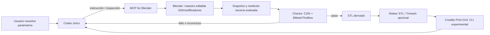

# SYN-01 — Síntesis y arquitectura candidata
**Fecha:** 2026-11-02. **Estado:** borrador documental, IN PROGRESS. Fuentes y criterios detallados en INV-01…05/08, CON-001 y VAL-001. Sin pruebas propias del pipeline.

## Hallazgo ejecutivo

Hay piezas reutilizables para conectar Codex a Blender, conservar un maestro editable, inspeccionar topología y revisar un STL. No hay evidencia documental ni propia que demuestre la cadena completa en este Mac Apple Silicon ni que CU-01 resulte imprimible. La arquitectura mínima provisional usa Codex único, MCP for Blender de ahujasid, Blender con GN/modificadores, una secuencia de verificaciones nativas, STL derivado y revisión de Creality Print. MCP Printable, skills EL4CTEO, Trimesh y CLI del laminador quedan candidatos experimentales, no dependencias aprobadas.

## Matriz de decisión

| Componente | Evidencia/capacidad observada | Compatibilidad/estado | Decisión provisional |
|---|---|---|---|
| Codex | Docs oficiales describen MCP y skills; tareas de investigación se delegaron solo para esta fase | Cadena local no probada | Único agente del pipeline mientras baste; skills como instrucciones opcionales |
| MCP for Blender `ahujasid` | Repo redirigido desde nombre antiguo; server inspecciona escena, ejecuta Python y reporta vistas | Receta Codex/stdio declarada; ARM64 y comportamiento no probados. Reporte seguridad issue 404 es de v1.6.0, no atribuir a v2.2.6 | Reutilizar como candidato principal; fijar versión y revisar seguridad antes de experimento |
| Skills `EL4CTEO/blender-skills` | Cinco skills identificadas; `asset-qa` contiene perfil print y código de checks | Codex declarado; Blender 5.2+ declarado; ARM64 no demostrado. Algunas reglas se orientan a assets visuales | Probar selectivamente; no instalar todavía; resultados del QA se comparan con controles |
| Blender Geometry Nodes/modificadores/.blend | Entradas paramétricas, propiedades y guardado permiten preservar modelo fuente | Apple Silicon soportado por Blender; edición, reapertura y rollback locales sin probar | Reutilizar como autoría; snapshots por operación futura |
| 3D Print Toolbox | Addon existente para análisis/reparación; historial documenta retiro de reparación con defecto | Blender addon; no certificado FDM | Reusar diagnóstico, no reparar/promover automáticamente |
| MCP Printable | Server/addon 0.2.3 declarado, checks de overhang/walls/clearance; README se mantiene alpha 0.1.x | Codex/Blender declarados; Apple Silicon y precisión no probados; handlers no auditados | No sumar aún segundo puente; comparar si Toolbox deja brecha concreta |
| Trimesh | Lectura STL y predicates distintos para watertight, winding e is_volume | Compatibilidad ARM64 de combinación no probada | Segunda lectura opcional del STL, solo si su independencia aporta evidencia |
| Creality Print | Repo documenta CLI y publicación incluye asset macOS ARM64; issue #634 reporta fallo de CLI en Windows 11/K2 Plus; #645 es solicitud, no especificación | K1C/macOS CLI sin prueba | Revisión GUI como ruta; experimento CLI breve separado |

Licencias visibles: ahujasid, skills, Printable y Trimesh declaran MIT; Blender GPL; Toolbox GPL-3.0-or-later; CrealityPrint declara AGPL-3.0 y licencia adicional en repo. Confirmar licencia de artefactos y dependencias en versión concreta antes de redistribuir. Conteos mutables de estrellas/issues no son medida de fiabilidad. Las experiencias comunitarias verificadas son casos puntuales; no se halló reproducción externa de CU-01.

## Flujo candidato

El contrato guarda requisitos e invariantes; Blender conserva la geometría editable; STL es exportación; slicer da evidencia de trayectorias y ajustes, no éxito de impresión. Logs describen operaciones, no sustituyen mediciones. Reintentos, snapshots y aceptación requieren procedimiento explícito.

## Decisiones y pendientes

**Recomendadas provisionalmente:** Codex solo; reutilizar MCP principal; conservar `.blend` maestro y exportación separada; usar métricas de malla más comprobaciones dimensionales/geométricas; revisión de Creality GUI; no crear servidor de validación ni logging propio al inicio.

**Pendientes bloqueantes:** espesor, base y drenaje; si 150×150 incluye relieve; detalle y juntas del ladrillo; fijar tolerancia experimental, versiones y permisos; probar compatibilidad completa y restauración. Ningún claim de compatibilidad por componente implica compatibilidad de punta a punta.

## Experimentos siguientes (requieren autorización de fase posterior)

1. Fijar versiones/releases/SHA y revisar dependencias/licencias/seguridad.
2. Comprobar MCP, inspección de escena, llamada sin mutación y estado incierto en escena desechable.
3. Guardar y reabrir `.blend`; cambiar ladrillos y validar invariantes.
4. Usar controles negativos para medir cobertura/falsos resultados de Toolbox, BMesh, skill QA y opcionalmente Printable/Trimesh.
5. Exportar STL, comparar unidades y geometría reimportada; revisar laminado GUI y CLI macOS por separado.
6. Solo después de establecer parámetros y criterios físicos, considerar impresión controlada.

Ninguno de estos experimentos fue ejecutado. Ver [SYN-02](SYN-02_cierre_fase2.md) para estado de salida.
