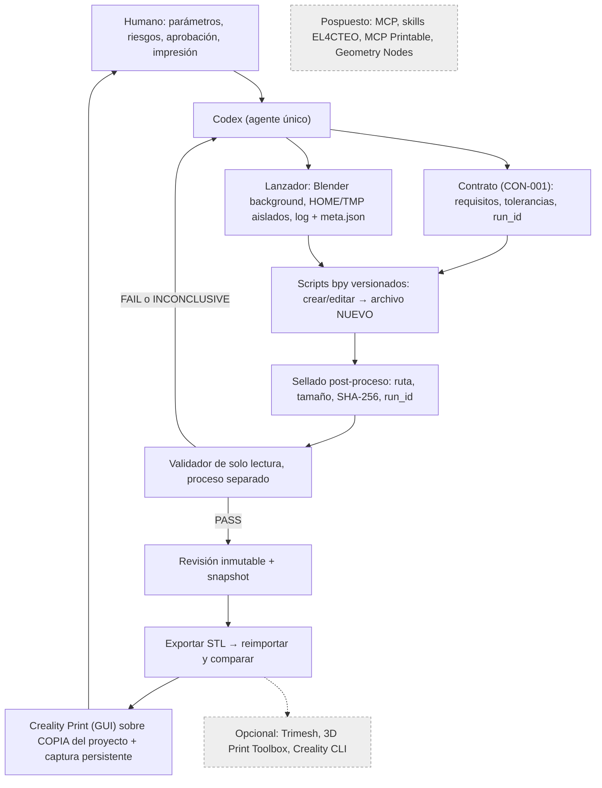

# Arquitectura vigente del laboratorio

**Fecha:** 2026-11-02. **Reemplaza como referencia vigente a:** `archivo/documentos_originales/ARQ-001_arquitectura_laboratorio_3d_IN_PROGRESS.md` (hipótesis con MCP, conservada como histórico). Decisiones: [ADR-0001](../05_decisiones/ADR-0001_bpy_directo.md), [ADR-0002](../05_decisiones/ADR-0002_politica_blender_alpha.md).

Todo lo marcado "demostrado" tiene experimento ejecutado (ver [TRAZABILIDAD](../03_contratos/TRAZABILIDAD.md)). Ninguna pieza se ha demostrado aún sobre CU-01, y ninguna con una impresión física.

## Flujo

## Componentes

| Componente | Estado | Evidencia | Nota |
|---|---|---|---|
| Codex como único agente | En uso | EXP-BPY-001…005 | Sin multiagente |
| Blender en background con perfil aislado | Demostrado (Alpha) | EXP-BPY-001, 002, 003 | No es un sandbox; ver ADR-0002 |
| Scripts bpy que escriben archivos nuevos | Demostrado | 001, 002, 003 | Sin sobrescribir revisiones aceptadas |
| Validación en proceso separado y de solo lectura | Demostrado | 002 (`validate_state`), 003 (`validate_relief_blend`, `validate_stl`) | Tres validadores distintos; falta un contrato común |
| Snapshot con reapertura y comparación | Demostrado | 002, 003 | |
| Guard de revisión (conflicto) | Experimental | 002 | El conflicto fue simulado con una copia divergente; el primer guard falló dos veces |
| Controles negativos | Demostrado, cobertura parcial | 002 (1), 003 (3) | VAL-001 propone 12 |
| Exportación STL y reimportación | Demostrado | 003 | Convención: coordenadas numéricas en mm (escala 1000) |
| Sellado de hashes automático | **No implementado hasta este paso** | INC-006 | Ver [INTEGRIDAD](../04_procedimientos/INTEGRIDAD.md) y `herramientas/` |
| Laminado en Creality Print (GUI) | Demostrado | 004, run `155417Z` | Sin G-code en el repositorio |
| Impresión física | No probado | 005 NOT RUN | Puerta humana |
| Geometría paramétrica reactiva | **Sin decidir** | 002 escala vértices; 003 reconstruye por script | Condiciona R06; próximo experimento tras 005 |

## Límites de confianza

- Los parámetros guardados en el `.blend` son metadatos, no reactivos (INC-003, EXP-BPY-003).
- "PASS" se refiere a la tolerancia experimental de cada ensayo, no a CU-01 ni a la K1C.
- Un proceso que termina con código 0 no basta: se exige medición posterior en un proceso separado.
- Un STL laminable no garantiza una pieza imprimible.

## Pospuesto y condición para reabrir

| Pieza | Condición para reconsiderarla |
|---|---|
| MCP for Blender | Que el bucle por lotes resulte demasiado lento o impida la revisión visual en CU-01, y entonces cumplir las 8 condiciones de SEC-008 |
| Skills EL4CTEO, MCP Printable | Una brecha concreta de validación que 3D Print Toolbox y los validadores propios no cubran |
| Geometry Nodes | Resultado del experimento de parametricidad (R06) |
| Trimesh, Creality CLI | Que aporten una segunda lectura independiente o automatización medible |
